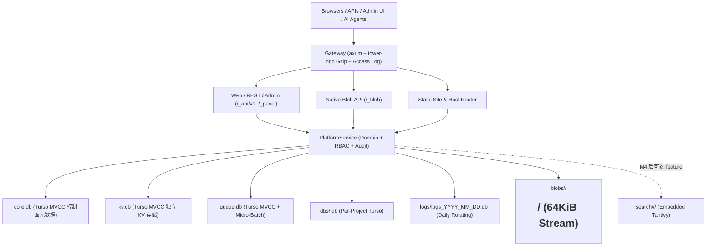

# ferropod 产品与开发文档 (v1.0)

> **产品定位**：AI-Native 轻量级自托管 PaaS（Pure Rust 单二进制 + 单 `/data` 目录，零外部中间件依赖，支持 **512 MiB RAM** VPS 稳定运行）。  
> **配套架构文档**：[ARCHITECTURE.md](ARCHITECTURE.md) ｜ **WIT 契约**：[../wit/platform.wit](../wit/platform.wit)

---

## 1. 产品概览与设计约束

| 维度 | 核心指标 / 约束 |
| :--- | :--- |
| **交付形态** | 单 Rust 二进制（`ferropod`）+ 单 `/data` 数据目录，内嵌零构建 Web 面板 `/_panel` |
| **内存预算** | 空载 RSS ~30–60 MiB；`--profile low-mem` 限制并发、用户库 LRU 句柄数与写缓冲，稳定运行于 **512 MiB RAM** |
| **存储原则** | 磁盘优先（Turso MVCC + 内容寻址本地 Blob FS），内存仅保留有界队列、热路由表与 OS Page Cache |
| **架构模式** | **1 Core Service + 3 Thin Adapters**：所有业务逻辑、RBAC 鉴权与审计收敛于 `PlatformService`，统一向 REST/Admin、WIT Host（M2 已落地）、MCP（M3）暴露 |
| **演进能力** | 存储与运行时全部面向 `src/core/traits.rs` 抽象，单机引擎可在 M4 无痛切换为分布式后端 |

---

## 2. 系统分层与代码目录



### 代码结构映射

| 路径 | 职责 |
| :--- | :--- |
| `src/main.rs` / `src/lib.rs` | CLI 入口（`serve` / `dev` / `token` / `snapshot` / `install-systemd`）与运行时装配 |
| `src/config.rs` | 配置与内存档位预设（`LowMem` / `Standard`） |
| `src/core/` | 领域模型 `model.rs`、抽象接口 `traits.rs`、加解密/签名 `crypto.rs`、业务服务 `service/*.rs` |
| `src/runtime/` | Wasmtime Component AOT `.cwasm` 运行时、WIT v0.2 Host Bindings、出站 HTTP、Epoch 超时与内存限制 |
| `src/storage/` | Turso 连接池与事务重试 `tx.rs`、`core_store/`、`kv_store.rs`、`queue_store.rs`、`user_db.rs`、`log_store.rs`、`blob_fs.rs` |
| `src/gateway/` | Axum 路由与 Gzip `router.rs`、静态站点与 Blob API `blob_api.rs`、鉴权与访问日志 `guard.rs`、TLS `tls.rs` |
| `src/dispatcher/` | 后台维护循环（KV TTL、Blob GC、队列租约回收、日志过期清理）与优雅停机 |
| `src/update.rs` | 版本检查、Release 查询与自更新逻辑 |
| `src/web/` | REST API `api.rs`、内嵌资源与 ETag/304 `mod.rs`、零构建前端 `assets/` |

---

## 3. 功能模块矩阵与实现状态

> 状态说明：**✅ 全栈可用** ｜ **🟡 前端组件 + Mock 预览** ｜ **⚠️ 部分缺口** ｜ **🗺️ 路线图规划**

| 模块 | 后台路由 | 后端状态 | 前端状态 | 项目隔离 | 已知缺口 / 备注 |
| :--- | :--- | :---: | :---: | :---: | :--- |
| **概览与实时性能监控** | `#/overview` | ✅ | ✅ | ✅ | 真实 `/proc` 指标（RSS / 宿主机内存 / Load / FD / Uptime）+ 5s SVG 实时折线 |
| **应用 (Apps)** | `#/runtime` | ✅ | ✅ | ✅ | Wasmtime AOT `.cwasm` 运行时、服务端 Wasm 编译、WIT v0.2 Host Bindings、出站 HTTP 与实时 Invoke 调试台 |
| **Secrets 密钥** | 项目详情内 | ✅ | ✅ | ✅ | AES-256-GCM 静态加密，按 `project_id` 强隔离 |
| **KV 存储** | `#/kv` | ✅ | ✅ | ✅ | 命名空间创建/列表/删除 + 键值 CRUD + TTL + 内存临时模式 + 原子自增 |
| **消息队列** | `#/queues` | ✅ | ✅ | ✅ | 队列创建/列表/修改配置/删除 + 微批入队 + 统计 + 巡检 + DLQ 重放 + 清空 |
| **对象存储 (Blob)** | `#/blobs` | ✅ | ✅ | ✅ | 5 端点流式存储 + 公开读 + HMAC 预签名 + 删除空 Bucket |
| **用户数据库 (Turso)** | `#/dbs` | ✅ | ✅ | ✅ | 每库独立物理文件 + 创建/列表/删除 + SQL 控制台 + Schema；搜索配置在查询时扫描所选表 |
| **全文搜索 (SearchStore)** | `#/search` | ✅ | ✅ | ✅ | 索引与文档持久化到 search.db，按文档扫描评分 |
| **访问令牌 (Tokens)** | `#/tokens` | ✅ | ✅ | ✅ | 仅 `admin` 可见；SHA-256 哈希存储，支持 `admin` / `readonly` / `project:<id>` |
| **日志中心** | `#/logs` | ✅ | ✅ / 🟡 | ✅ | 实时 SSE 流 + 历史查询已全栈可用；历史全文索引支持 Mock FTS / 实时接口切换 |
| **备份与快照** | `#/ops` | ✅ | ✅ | ✅ (`admin`) | 一键一致性 Turso 快照（`/data/backups/`）、列表查看、文件清单与删除 |
| **定时任务 (Cron)** | `#/ops` | ✅ | ✅ | ✅ | 持久化至 `core.db` (`cron_jobs`)，支持标准 5 段表达式与 `@every` 定时调度触发 Worker `scheduled` / HTTP 回调，并写入 `cron` 日志 |
| **系统更新** | `#/update` | ✅ | ✅ | ✅ (`admin`) | 版本信息、Release 列表检查与自更新触发 |

---

应用、数据库、KV 命名空间、队列和存储桶可在各自页面按名称分组。创建资源时选择已有分组或输入新名称。同名分组可包含多种资源和多个应用。资源归属与令牌作用域仍通过应用 ID 管理。

应用详情的「环境变量与密钥」页提供两种设置。普通变量随部署版本保存，提交后生成待发布版本。密钥按应用加密保存，管理台仅展示键名。

## 4. 安全与多项目隔离 (RBAC)

- **三级 Token 作用域**：
  - `admin`：全平台读写权限，可管理全局资源、令牌、快照备份与系统更新。
  - `readonly`：全局只读权限，写操作被后端 Service 与前端 UI 同步禁用。
  - `project:<id>`：严格隔离在指定项目内——Projects、Routes、Secrets、KV、Queues、Buckets、Databases、Logs（含 SSE 实时流）均按 `project_id` 过滤与鉴权。
- **凭证与签名**：
  - Secrets：基于 `FERROPOD_MASTER_KEY` 派生密钥 + 12 字节随机 Nonce 的 `AES-256-GCM`。
  - API Token：服务端仅存 `SHA-256` 摘要，签发时明文仅展示一次。
  - Blob 预签名：无状态 `HMAC-SHA256(op:bucket:key:exp)` 常量时间校验。

---

## 5. 前端架构规范（零构建 + 原生 HTML 组件化）

管理后台位于 `src/web/assets/`，通过 Rust `include_str!` 直接编译进二进制，**无需 Node.js / Vite / Webpack**。

### 5.1 核心技术规范
- **原生 Web Components**：新功能统一采用 **ES Modules + Custom Elements v1 + Shadow DOM + Constructable Stylesheets (`new CSSStyleSheet()` / `adoptedStyleSheets`)**。
- **语义化原生 HTML**：弹窗使用原生 `<dialog>`（`showModal()` / `::backdrop`），搜索区使用 `<search>`，高亮使用 `<mark class="fts-hl">`，折叠使用 `<details>/<summary>`。
- **主题穿透**：Shadow DOM 自动继承 `:root` 与 `[data-theme="dark"]` 的 CSS 自定义属性（`--bg`、`--surface`、`--border`、`--text`、`--accent` 等）。
- **解耦通信**：组件向主壳通过 `CustomEvent(..., { bubbles: true, composed: true })` 通信（如 `fp-toast`、`fp-open-sql`、`fp-log-query`）。

### 5.2 前端模块清单

| 文件 | 角色 | 加载方式 |
| :--- | :--- | :--- |
| `index.html` / `styles.css` | 壳骨架、官方六边形星芒 SVG Logo、浅/深色主题变量 | 首屏同步 |
| `i18n.js` | 中/英双语词典（`zh-CN` / `en`）与时间/字节格式化 | 首屏同步 |
| `app.js` | Hash 路由、双存储 Token 持久化（`localStorage` + `sessionStorage`）、401 会话探活、旧版视图 | 首屏同步 |
| `perf_component.js` | `<fp-perf-monitor>` 实时性能监控（SVG 折线） | **ESM 动态 `import()` 懒加载**（`#/overview`） |
| `search_mock.js` / `search_components.js` | `<fp-search-workbench>`、`<fp-db-fts-panel>`、`<fp-log-search-panel>` | **ESM 动态 `import()` 懒加载**（`#/search`、`#/dbs` FTS、`#/logs`） |
| `ops_component.js` | `<fp-ops-center>` 备份快照 + 定时任务中心 | **ESM 动态 `import()` 懒加载**（`#/ops`） |
| `runtime_component.js` | `<fp-runtime-panel>` 运行时工作台 + `<fp-project-bindings>` 可视化资源绑定 | **ESM 动态 `import()` 懒加载**（`#/runtime`、`#/runtime/:id`） |
| `update_component.js` | 系统版本与更新中心组件 | **ESM 动态 `import()` 懒加载**（`#/updates`） |

### 5.3 传输与缓存优化
- **Gzip 压缩**：`src/gateway/router.rs` 挂载 `tower_http::compression::CompressionLayer`，`app.js` 实测从 **124 KB → 21 KB**（压缩率 ~83%）。
- **ETag / 304**：`src/web/mod.rs` 启动时计算各静态资源 SHA-256 `ETag`，命中 `If-None-Match` 直接返回 `304 Not Modified`（0 字节传输）。

---

## 6. 核心 REST API 速查

| 分类 | 端点 | 说明 |
| :--- | :--- | :--- |
| **系统与监控** | `GET /_healthz`、`GET /_api/v1/status`、`GET /_api/v1/metrics` | 健康检查、会话/资源统计、实时 `/proc` 性能指标 |
| **系统更新** | `GET /_api/v1/system/info`、`GET /_api/v1/system/update/check`、`GET /_api/v1/system/releases`、`POST /_api/v1/system/update/apply` | 版本信息、检查更新与应用升级（admin） |
| **备份快照** | `GET/POST /_api/v1/backups`、`DELETE /_api/v1/backups/{name}` | 一致性 Turso 快照管理（admin） |
| **项目与路由** | `GET/POST /_api/v1/projects`、`PUT .../artifacts/{*path}`、`POST .../invoke`、`GET/DELETE /_api/v1/projects/{id}`、`POST .../promote` / `rollback`、`GET/POST /_api/v1/routes` | 项目、产物上传与 AOT 预编译、Worker 在线调用、部署版本流转、域名路由 |
| **Secrets & Tokens** | `GET/POST /_api/v1/projects/{id}/secrets`、`DELETE .../secrets/{key}`、`GET/POST /_api/v1/tokens`、`DELETE /_api/v1/tokens/{id}` | 加密密钥与 RBAC 令牌管理 |
| **KV 存储** | `GET/POST /_api/v1/kv`、`GET/DELETE /_api/v1/kv/{ns}`、`GET/PUT/DELETE /_api/v1/kv/{ns}/{key}`、`POST .../incr` | 命名空间与键值完整 CRUD |
| **消息队列** | `GET/POST /_api/v1/queues`、`DELETE /_api/v1/queues/{name}`、`POST .../enqueue`、`GET .../stats`、`GET .../inspect`、`POST .../dlq/replay`、`POST .../purge` | 持久化队列、巡检、删除与死信治理 |
| **对象存储** | `GET/POST /_api/v1/buckets`、`PATCH /_api/v1/buckets/{name}`、`POST .../presign`、`PUT/GET/HEAD/DELETE /_blob/{bucket}/{key}` | 存储桶管理与流式对象读写 |
| **用户数据库** | `GET/POST /_api/v1/dbs`、`DELETE /_api/v1/dbs/{id}`、`GET /_api/v1/dbs/{id}/schema`、`POST .../query`、`POST .../execute` | 项目隔离 Turso SQL、删除与表结构 |
| **日志中心** | `GET /_api/v1/logs`、`GET /_api/v1/logs/stream` | 历史按天查询与 SSE 实时流 |

---

## 7. 全文搜索后端落地设计（统一 Tantivy 内核）

为兼容 512 MiB RAM 限制且不引入外部搜索引擎，后端统一基于 **Tantivy** 分三层落地：

1. **用户数据库 FTS**：开启 `turso` 0.8 内置 `fts` feature（底层为 `turso_core` 集成的 Tantivy），支持 `CREATE INDEX ... USING fts`，原生兼容 MVCC 与快照。
2. **独立 `SearchStore` 原语**：在 `src/core/traits.rs` 新增 `SearchStore`，索引落盘 `/data/search/<project_id|_global>/<index_id>/`，接入 `tantivy-jieba`（全局 `OnceLock<Arc<Jieba>>` 共享词典），通过 `/_api/v1/search/*`、`wit/platform.wit` 和 MCP 暴露。
3. **每日日志 FTS**：随 `DailyLogStore` 500ms 微批写入按天伴生轻量索引 `/data/logs/fts_YYYY_MM_DD/`（`IndexRecordOption::Basic` 省去位置信息，过期直接 `remove_dir_all`）。
4. **512 MiB 内存硬约束**：
   - `IndexWriter` 内存上限设为 `15 MiB` 且 `low-mem` 单线程写（`writer_with_num_threads(1, 15_000_000)`），空闲 30–60s 自动 `commit` 并释放。
   - `IndexReader` 采用 LRU 句柄池（`low-mem` 上限 4–6 个），依赖 `mmap` + OS Page Cache。

---

## 8. 开发、测试与运行指南

```bash
# 1. 本地开发模式（自动初始化 .ferropod-dev 并打印管理员令牌）
cargo run -- dev --bind 0.0.0.0:18080

# 2. 运行全部单元测试与集成测试
cargo test --no-fail-fast

# 3. 生产构建（低内存 512 MiB VPS 推荐 --profile low-mem）
cargo build --release
./target/release/ferropod serve --profile low-mem --data-dir /var/lib/ferropod --bind 0.0.0.0:8080

# 4. 签发令牌与一致性快照
./target/release/ferropod token create --name admin --scope admin
./target/release/ferropod snapshot --out /var/lib/ferropod/backups/manual
```

---

## 9. 研发路线图与待办清单 (Backlog)

### 近期优先（P0 收尾）
- [x] **补齐核心容器级删除 CRUD**：`DELETE /_api/v1/dbs/{id}`（含清理物理文件）、`DELETE /_api/v1/queues/{name}`、`DELETE /_api/v1/kv/{ns}`（均已接通前后端与 RBAC）。
- [ ] **其余管理增强**：队列配置修改、`DELETE /_api/v1/buckets/{name}`（空桶）。
- [ ] **定时任务落盘与调度**：在 `core.db` 新增 `cron_jobs` 表，暴露 `/_api/v1/crons/*`，由 `dispatcher` 定时扫描触发并写入 `logs`（`source = "cron"`）。
- [ ] **前端 `app.js` 进一步模块化**：将旧版 120 KB 单体 `app.js` 拆为 `core.js` + `views/*.js` 按路由懒加载。

### 里程碑演进（M2 – M4）
- [x] **M2（运行时与调度，已完成）**：Wasmtime AOT `.cwasm` 运行时 + 服务端 Wasm 编译 + `ferropod:platform@0.2.0` WIT 强类型 Host Bindings + `wasi:http/outgoing-handler` 出站 HTTP + 队列消费与 Cron 定时调度。
- **M3（AI Native MCP Server）**：内置 `rmcp` MCP Server（`/mcp` & stdio），聚焦 `deploy_stack`、`worker_invoke`、`logs_query` 等核心原语工具。
- **M4（高可用与演进）**：健康检查自动回滚、Webhook 告警、发布包自动化，以及多节点 trait 后端（Turso Embedded Replicas / NATS / S3 兼容存储）。
- **M4+（可选 `--features search`）**：开启 `turso/fts` 与嵌入式 Tantivy + `tantivy-jieba` 全文搜索（作为可选编译 feature 挂载，避免默认占用 512 MiB 内存预算）。
